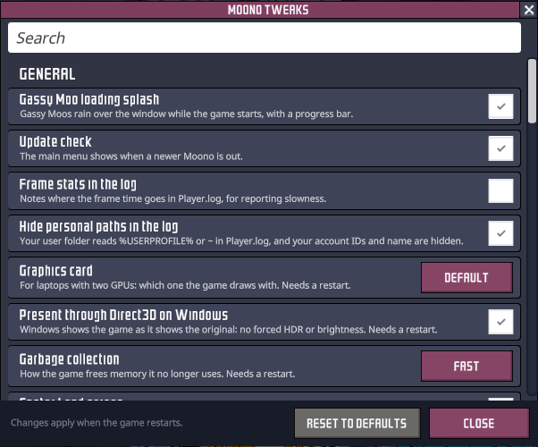

# Moono

[English](README.md) | [简体中文](README.zh-CN.md)

An unofficial, super fast, super sussy replacement for the Unity layer of Oxygen Not Included,
artisanally crafted by Claude. On a late-game colony the game runs at up to 13× the original's
frame rate ([Performance](#performance)).

<p align="center"></p>

I did this mostly for fun, to see how far Oxygen Not Included's performance can go on a modern
.NET runtime (CoreCLR). I've had the idea for a while, but none of the existing C# renderers
sparked joy. When [BRUTAL](https://github.com/ahwootech/BRUTAL) went open source, it seemed like
a good excuse to try a sexy new toy.

Moono runs Klei's original DLLs, patched at load where Mono and .NET
[differ](docs/ARCHITECTURE.md). Everything they need from Unity is reimplemented here.

## Setup

You need your own copy of the game on Steam, on Linux or Windows (no macOS). Epic Games Store
and WeGame (China) are not currently supported. Because this replaces
the engine rather than patching the game, it can't ship as an ordinary Harmony mod. Instead, a
setup script hooks it into the game's Steam launch options, so you still start the game from
Steam as usual.

### Easy installation

1. Download the latest release from the
   [releases page](https://github.com/tigin-backwards/oni-moono/releases/latest):
   `oni-moono-…-windows-x64.zip` or `oni-moono-…-linux-x64.tar.gz`, and extract it anywhere.
   (Or clone this repository; the setup then builds the player itself, installing the .NET SDK
   for your user if you don't have it.)
2. Run the setup script in the extracted `oni-moono` folder:
   - Windows: double-click `setup.cmd` (it runs `setup.ps1` and keeps the window open)
   - Linux: `./setup.sh`

   It finds your Oxygen Not Included install through Steam, and prints one line for the game's
   launch options, and puts it on your clipboard where it can.
3. In Steam, right-click Oxygen Not Included → Properties → Launch Options, and paste that line.

   

Then press Play in Steam as usual. The optional tweaks (below) are chosen in the game: **Moono
Tweaks** on the main menu, under Mods. To update, get the new version and run the setup again; the
launch options stay the same, and so do your tweak choices. To go back to the original game, clear
the launch options.

On Linux, Steam installed as a Flatpak or a snap runs games in a sandbox that can't see most of
your home folder; the setup notices and installs the player inside the sandbox's own folder.
(Snap is tested; Flatpak isn't yet.)

You'll need an OpenGL 4.5 graphics driver. The game uses your normal Steam account, DLCs, saves,
settings and mods.

### Manual installation

The setup script (see above) is the easiest installation on most systems. If you want more
control, need to customize the installation, or run a sandboxed environment and prefer not to run
a script outside of that, follow these manual steps. They don't include instructions on how to
build the player from scratch; see the setup scripts for the build steps, or
[docs/DEVELOPMENT.md](docs/DEVELOPMENT.md).

<details>
<summary>Linux</summary>

The example paths match those used by `setup.sh`, with `~/Downloads/oni-moono/` as the location
of the downloaded and extracted files. You can choose different paths, but update them
consistently in the commands and Steam launch options below.

1. **Locate the game folder.** It must contain `OxygenNotIncluded` and
   `OxygenNotIncluded_Data/Managed`. Common Steam library locations include:

   - Default Steam: `~/.steam/steam/steamapps/common/OxygenNotIncluded` or
     `~/.local/share/Steam/steamapps/common/OxygenNotIncluded`
   - Snap Steam: `~/snap/steam/common/.local/share/Steam/steamapps/common/OxygenNotIncluded`
   - Flatpak Steam:
     `~/.var/app/com.valvesoftware.Steam/.local/share/Steam/steamapps/common/OxygenNotIncluded`

   If the game is in another Steam library, use that library's `steamapps/common/OxygenNotIncluded`
   folder instead. Confirm that `OxygenNotIncluded` is the Linux executable; a Windows installation
   via compatibility tools (Proton) will not work.

2. **Place the player where Steam can access it.** In the downloaded archive, the `player` folder
   should contain the `OniMoono` executable and its accompanying files.

   (The `rm -rf` commands in the following examples remove a previous `player` folder, in case you
   are updating. Check the path before running them, or use your file manager instead.)

   For a regular Steam installation, you can leave the `player` folder where you extracted the
   archive (`setup.sh` does so), or copy it somewhere convenient:

   ```bash
   # Default Steam
   mkdir -p "$HOME/.local/bin/oni-moono"
   rm -rf "$HOME/.local/bin/oni-moono/player"
   cp -rp "$HOME/Downloads/oni-moono/player" "$HOME/.local/bin/oni-moono/player"
   ```

   Snap and Flatpak Steam run in sandboxes and may not be able to access files elsewhere in your
   home folder. Copy the player into Steam's sandbox-visible location:

   ```bash
   # Snap Steam
   mkdir -p "$HOME/snap/steam/common/oni-moono"
   rm -rf "$HOME/snap/steam/common/oni-moono/player"
   cp -rp "$HOME/Downloads/oni-moono/player" "$HOME/snap/steam/common/oni-moono/player"
   ```

   ```bash
   # Flatpak Steam
   mkdir -p "$HOME/.var/app/com.valvesoftware.Steam/data/oni-moono"
   rm -rf "$HOME/.var/app/com.valvesoftware.Steam/data/oni-moono/player"
   cp -rp "$HOME/Downloads/oni-moono/player" \
     "$HOME/.var/app/com.valvesoftware.Steam/data/oni-moono/player"
   ```

3. **Check the executable bit.** The player binary `OniMoono` must be executable. Set it if needed,
   using the path where you placed the player:

   ```bash
   chmod +x "$HOME/.local/bin/oni-moono/player/OniMoono"
   ```

   For Snap or Flatpak, use the corresponding paths above. Check that the file exists and is
   executable with `ls -l`.

4. **Set Steam's launch options.** In Steam, right-click Oxygen Not Included → Properties → Launch
   Options. Enter one line, replacing the example path with the full path to your player:

   ```text
   "/home/your-username/.local/bin/oni-moono/player/OniMoono" -- %command%
   ```

   For Snap, the executable path is typically:

   ```text
   "/home/your-username/snap/steam/common/oni-moono/player/OniMoono" -- %command%
   ```

   For Flatpak, it is typically:

   ```text
   "/home/your-username/.var/app/com.valvesoftware.Steam/data/oni-moono/player/OniMoono" -- %command%
   ```

   Replace `/home/your-username` with your actual home folder path. Do not use a literal `~` or
   `$HOME` in the launch options. Keep the quotes around the executable path, especially if it
   contains spaces.

Press Play in Steam. If the game does not start, check that the launch options path matches the
player's actual location, `OniMoono` has its execute bit set, and the game folder contains the
Linux build. If that doesn't help, launch Steam from a terminal and watch the output for a hint
after clicking Play.

For updates, download the new release archive and repeat the steps, replacing the `player` folder.

To remove Moono and return to the original game, remove the `player` folder from where you put
it, and clear the launch options in Steam.

</details>

<details>
<summary>Windows</summary>

1. **Place the player.** In the downloaded archive, the `player` folder contains `OniMoono.exe`
   and its accompanying files. Copy it to `%LOCALAPPDATA%\oni-moono\player`, the location
   `setup.ps1` uses (paste `%LOCALAPPDATA%` into Explorer's address bar to open it). You can
   choose a different folder, but with this one, running the setup later keeps the same launch
   options. In case you are updating, remove the previous `player` folder first.

2. **Set Steam's launch options.** In Steam, right-click Oxygen Not Included → Properties → Launch
   Options. Enter one line, replacing the example path with the full path to your player:

   ```text
   "C:\Users\your-username\AppData\Local\oni-moono\player\OniMoono.exe" -- %command%
   ```

   Replace `C:\Users\your-username` with your actual user folder path. Do not use
   `%LOCALAPPDATA%` in the launch options. Keep the quotes around the executable path.

Press Play in Steam. If the game does not start, check that the launch options path matches the
player's actual location.

For updates, download the new release archive and repeat the steps, replacing the `player` folder.

To remove Moono and return to the original game, remove the `player` folder, and clear the launch
options in Steam.

</details>

## Performance

The biggest change is swapping the very garbage Mono runtime that Unity ships for CoreCLR. On
top of that there are optimizations tuned to the way Oxygen Not Included uses the engine.

On a late-game Spaced Out colony with every DLC (cycle 17,000+), on Windows, on the same machine, back to back, with every Moono tweak on:

| | Original | Moono | |
|---|---|---|---|
| Frame rate at speed&nbsp;3 | about 11&nbsp;fps | about 144&nbsp;fps | about 13× |
| Loading the save | 2&nbsp;min&nbsp;22&nbsp;s | about 25&nbsp;s | about 5.5× faster |
| Autosave freeze | about 26&nbsp;s | about 2.2&nbsp;s | about 12× shorter |
| Starting the game, to the main menu (every DLC, second launch) | about 17.4&nbsp;s | about 10.3&nbsp;s | about 1.7× faster |

How much faster it runs depends on your hardware. Moono removes the runtime's overhead, so the
faster your CPU, the more of the gain you see. On slower machines, you'll get bottlenecked by other
things sooner: running out of memory, or the game's C++ simulation itself, which Moono doesn't
speed up (particularly on very large custom maps).

Garbage-collection hitches are mostly gone: collections now run in the background, spread
across every core, and their pauses are about a quarter as long.

**Note:** This uses more memory compared to the original. On a mid-game colony, memory peaked at
around 11 GB resident compared to 7 GB in the original. This is expected behavior for faster,
parallel collection.

The late-game colony at speed 3: about 11 fps in the original, about 136 in Moono.

https://github.com/user-attachments/assets/5775cbda-42b6-49cb-b178-669fdbeb9f0a

Starting the game to the main menu, every DLC, second launch: 17.5 s in the original, 9.8 s in
Moono.

https://github.com/user-attachments/assets/f73ebf1a-8440-4579-ab2a-0b2eaa2a6853

An autosave on the late-game colony: the original freezes for about 25 s, Moono for about 2.1 s.

https://github.com/user-attachments/assets/02076cf7-15ec-406a-889d-254ceb7a3e61

The temperature overlay on the late-game colony, panning: about 7 fps in the original, about 57 in Moono.

https://github.com/user-attachments/assets/99767c1f-8600-467c-94c3-f92398aa833d

A mid-game colony at speed 3: about 28 fps in the original, about 126 in Moono.

https://github.com/user-attachments/assets/e5293dda-2aa1-4dd9-9ef8-eeaa8808e7dd

For a more detailed breakdown, see [docs/PERFORMANCE.md](docs/PERFORMANCE.md).

### Tweaks

Moono also speeds up some of the game's own code. Most tweaks don't change gameplay and are on by
default; four do, and are off. Toggle them in **Moono Tweaks** on the main menu. Full list:
[docs/TWEAKS.md](docs/TWEAKS.md).


<p align="center"></p>

## Save compatibility

Saves from the original game should load, and saves made here should still load in the
original game (including ones written with the `fast-save-compression` tweak).

Saves come out about 14% larger: the `fast-save-compression` tweak compresses them faster but a
little less tightly, which takes seconds off every save.

## Mod compatibility

Most mods should work, since the game's code and its Harmony load as shipped. See
[docs/MOD_COMPATIBILITY.md](docs/MOD_COMPATIBILITY.md) for what has been tested. If a mod breaks,
[file an issue](#issues) with your log.

## Could Klei do this?

Possibly. In the age of agents the initial prototype took about 5 days, so it isn't the
insurmountable task it might once have looked like.

However, most of the wins come from CoreCLR itself, which Unity 7's CoreCLR move should bring to
the original game too, eventually (it's been in Soon™ territory for years).

This also rebuilds only what the game needs to run. Everything that Klei's development workflow
needs from Unity would be lost:
- the editor
- Unity's shader tooling
- the asset bundle build pipeline
- profiling and debugging tools
- no macOS support yet
- the general, accumulated knowledge of how Unity behaves

So I'd only seriously look at something like this if Unity 7's CoreCLR runtime can't get
close to the same numbers.

The optional tweaks are a different story. They are potential optimizations that probably also
apply to the original game. I haven't measured them there, though, and their gains could differ
on Mono. The engine-side wins are probably not possible to port to the original game, as it
would require building Unity from source.

## Contributing

Feel free to slop. See [docs/DEVELOPMENT.md](docs/DEVELOPMENT.md).

## Issues

[File an issue](https://github.com/tigin-backwards/oni-moono/issues), and please attach your log and the save you were playing.

The log is `Player.log` in:
- Windows: `%USERPROFILE%\AppData\LocalLow\Klei\Oxygen Not Included\`
- Linux: `~/.config/unity3d/Klei/Oxygen Not Included/`

Saves are `.sav` files in a folder named after the colony, under:
- Windows: `Documents\Klei\OxygenNotIncluded\cloud_save_files\<your Steam ID>\` (or
  `save_files\` for saves kept off Steam Cloud)
- Linux: `~/.config/unity3d/Klei/Oxygen Not Included/cloud_save_files/<your Steam ID>/` (or
  `save_files/`)

With Steam installed as a snap on Linux, both folders are under `~/snap/steam/common/` instead
of `~`. With Flatpak Steam, `~/.config/` becomes `~/.var/app/com.valvesoftware.Steam/config/`.

## License

All rights reserved.

Built on [BRUTAL](https://github.com/ahwootech/BRUTAL), Copyright (c) 2024 Ahwoo Limited.
Oxygen Not Included is © Klei Entertainment. Moono is unofficial, and not affiliated with or
endorsed by Klei Entertainment, Unity Technologies, or the Mono project.

Moono is written without Unity's source code: no Unity C# reference source, decompiled Unity
assemblies or disassembled engine binaries are used. Unity's UI packages (uGUI, TextMeshPro,
Timeline) are reimplemented clean-room: their behaviour is measured from the outside, written up
as specs in [docs/cleanroom](docs/cleanroom), and implemented from those specs. Code from
open-source projects (Mono, Mesa, SGI's GLU) is used under their licences; see
[NOTICE.txt](NOTICE.txt) and [docs/LICENSING.md](docs/LICENSING.md).

## Unsigned releases

The releases are not signed, so to Windows every new one is an unknown program from the
internet. Extracting it or running setup may hold things up for a cloud antivirus scan, or show
"Windows protected your PC" (click More info → Run anyway). That's okay and expected for sussy
software like this. To skip most of it, right-click the downloaded zip → Properties → tick
Unblock before extracting.
