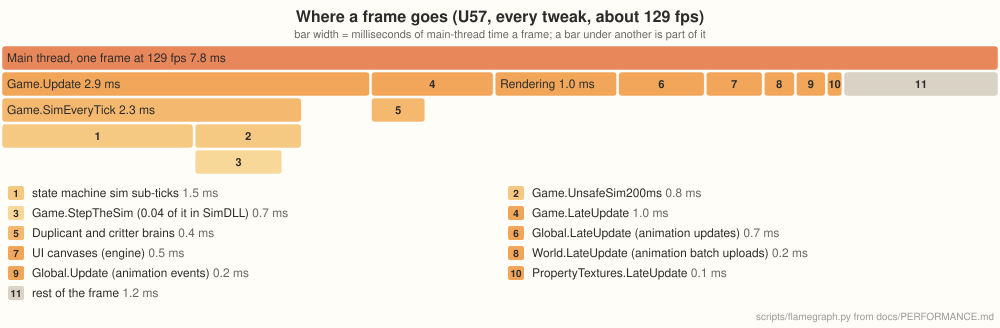

# Performance

How fast Moono runs against the original game, why, and what's still in the way. Four
colonies stress it differently, so each has its own case study:
- **U57**, late game, held back by the game's own logic (this document);
- **2minnow**, mid game, where more of the frame is drawing
  ([PERFORMANCE_CASE_STUDY_2.md](PERFORMANCE_CASE_STUDY_2.md));
- **Gluttony**, very late game with 67 Duplicants, where the simulation's many small updates
  take most of the frame ([PERFORMANCE_CASE_STUDY_3.md](PERFORMANCE_CASE_STUDY_3.md));
- **a heavily modded colony** with 139 mods, where two mods cost more than the colony itself
  ([PERFORMANCE_CASE_STUDY_4.md](PERFORMANCE_CASE_STUDY_4.md)).

Other test colonies named in the tables below:
- **c100**, a 200-Duplicant colony;
- **DeCrew**, a late-game base-game colony (cycle 17,600+, 15 Duplicants);
- **soggy lab 2**, a large colony from a player's report, played with their mods.

The raw working notes, dead ends included, are in
[research/u57-frame-inventory.md](research/u57-frame-inventory.md).

## How it's measured

On native Windows 11: a Ryzen 7 9800X3D (8 cores, 16 threads), an RTX 3090 with NVIDIA's own
OpenGL driver. Both players load the same save at 1280×720, windowed, with the same probe mod
(`tools/PerfProbe`) holding speed 3 and logging the frame rate every 600 frames. The probe also
turns vsync off and keeps the game from sleeping when its window loses focus (the game slows
itself down then), the same in both players. The original runs as an isolated copy of the
installed game; neither touches the user's own saves or Steam account.

Moono's figures are from 2026-11-06: release v2026.11.06.01 (master 4f383caa) on the game's U59
build 744825 with every DLC. Each configuration ran three times with nothing else running
(2minnow with every tweak a fourth time, as one run was far from the others). Each launch is the
second in a fresh run home (a warm-up launch to the main menu first), unfocused on the second
monitor at High priority, and measures everything once: the time to the main menu, the save's
load, 15 windows of 600 frames, then three autosaves, with the working set sampled every second.
A launch's frame rate is the mean of its windows, leaving out the first three (warm-up) and those
holding an autosave; the tables give the median of the launches and, in brackets, the lowest and
highest. Runs on a desktop move by up to a quarter when something else wakes up, and U57 also
runs faster once its cycle ends partway through the windows. The tables' launches ran without
`--frame-stats`, whose timing patches cost up to about 15% of the frame rate with every tweak
(U57: 144 fps without them, 129 with); a second set of launches with it gives the breakdown in
[Where a frame goes now](#where-a-frame-goes-now). "Default tweaks" is what a player gets with no
settings changed: every exact tweak, `path-probe-repair`, `instant-reachability` and the bug
fixes marked on by default ([TWEAKS.md](TWEAKS.md)). The original's figures are from 2026-10-22:
the median of at least two runs, the ranges its 600-frame windows. Nothing records the screen
during these runs.

Earlier numbers were taken on Linux under WSL2, where OpenGL goes through Mesa's Direct3D 12
backend. That layer makes some driver calls far more expensive than on a native driver (a small
texture upload cost about 75 µs there against about 2.5 µs on Windows), and the game's own code
also ran about half as fast. The case studies' deep dives that still come from Linux say so.

## Frame stats in a player's log

A player who reports slowness can turn on **Frame stats in the log** (Moono Tweaks, General) or
start with `--frame-stats`. Player.log then gets, every 60 frames, the frame's phases (`frame
stats`), the device's counts (`frame counts`: the GL thread's time, draws, uploads, the
presenter's time per picture) and any frame over 250 ms (`slow frame`). Every 600 frames come
the scripts' update times (`script time`), memory (`memory:`: the working set and its peak, the
managed heap, collections; `video memory:`), and these lines,
all in ms a frame over the window unless they say otherwise. `video memory:` is also logged at
the main menu, after each scene load and after `Resources.UnloadUnusedAssets`: the driver's free
memory (NVIDIA's evictions since the device started, and those the whole system saw), the
device memory asked for by kind (textures by format, render target colour, depth and
multisampled surfaces, mesh and stream buffers) with each kind's peak since the last line, the CPU memory uploads go through (pooled
texel copies, texels read ahead of background uploads, all texel memory) and the engine's live
textures ([research/vram-startup.md](research/vram-startup.md)).

- `game speed`: the speed setting, game seconds a real second (what the game asked for, and what
  it got), the sim's 200 ms steps and its calls a frame, how many frames hit the game's limit of
  200 ms of game time a frame (above it the game slows down rather than step more), and how
  many were paused.
- `sim`: `Game.SimEveryTick`, `UnsafeSim200ms` and `StepTheSim`, each split into time inside
  SimDLL (the native simulation) and the managed rest, then all of the main thread's SimDLL
  calls and their count.
- `game update`: the state machine buckets by update rate (render every tick, render 200 ms and
  1000 ms, sim every tick, 33 ms, 200 ms, 1000 ms and 4000 ms; `BrainScheduler` runs inside
  render every tick), brains, cell info, nav grids, path probes, anim events and the game's
  jobs, with calls a frame, and how long the main thread waited for the job workers.
- `main thread waits`: for the device to take the next frame (the previous one still drawing),
  for results from it (read-backs, diagnostics), for last frame's texel copies; the device
  thread waiting for the presenter; GC pauses and collections in the window (with the longest
  pause seen, of the last collection at each frame's end, and the most a frame was paused in
  all), allocation, JIT
  time on all threads, lock contentions and the thread pool (threads, queued items).
- `machine`: the process's CPU in cores and the main thread's share of the time, page faults
  (hard faults: the process's on Linux, the system's disk reads for them on Windows), available
  RAM and commit, and where the system offers them: AC or battery, battery saver, the power
  plan and mode (Windows) or platform profile and governor (Linux), and the CPU clock against
  its rated one. Windows often reports the rated clock as the current one; a `limit` below it
  means the CPU is held back.

The game's parts are timed by patches made at start-up only with frame stats on (a prefix first
and a postfix last, so mods' patches of a method count in its time). SimDLL's time is that of
the game's calls of its P/Invokes (the sim's messages, among them the step itself, and the
conduit temperature update), timed at each call site in Sim, SimMessages and
ConduitTemperatureManager. With frame stats off none of it is installed or counted. The patches
cost frame rate where the frame is short: on Windows (2026-11-06) U57 ran at 129 fps with every
tweak and frame stats on, against 144 with them off, and at 47 against 51 with no tweaks; with
the default tweaks the two were within the runs' spread (91 and 90). 2minnow lost 6–7% in each.

Two settings for test runs go with frame stats:
- `ONI_BUCKET_PROFILE=1`: the state machine buckets' loop runs with each bucket timed (the same
  calls in the same order), and each 600-frame window adds `bucket profile` lines: the 40
  costliest update kinds, each with its rate, ms a frame, calls a frame, entries a call, µs an
  entry, the bucket's name, its data type and the callback or updater it runs.
- `ONI_FRAME_STATS_AB=TYPE, ASSEMBLY FIELD`: a static bool (a tweak's `Bypass`, such as
  `OniMoono.GameTweaks.FastSmiLookups, OniMoono.GameTweaks Bypass`) flipped after every 600-frame
  window, whose lines end with `frame stats ab: FIELD=VALUE` for the value it ran with: a change
  and itself switched off, alternating in one run.

## Managed allocations against the original

`tools/PerfProbe` with `alloc.txt` logs a `PERF alloc` line after each 600-frame window: running
totals of what the managed heap handed out, so two lines give a span's KB a frame, MB a game
second and MB a real second (powers of 1,000). Both players load the same save with the same probe at speed 3;
`fps.txt` caps the frame rate (vsync off), to measure ours at the original's frame rate, since
fewer frames a game second means less per-frame work in each.

- The original: Boehm's own total, `GC_get_total_bytes`, called in the libmonobdwgc the player
  loaded (both the U59 release build and the U60 development build export it). It counts heap
  bytes as Boehm hands them out, rounded up to its size classes with a byte added for interior
  pointers: the probe's calibration measures a plain object at 32 B, a `byte[100]` at 144 B and a
  `byte[100000]` at 100,048 B. U60's development build also has Unity's "GC Allocated In Frame"
  counter, which comes to about 0.86 of Boehm's total (object sizes, main thread only).
- Ours: .NET's `GC.GetTotalAllocatedBytes(true)` (a plain object is 24 B), with its pause total
  and collection counts. The calibration's objects go into a static field; .NET stack-allocates
  ones that never escape.
- Both: a heap-growth estimate from `Profiler.GetMonoUsedSizeLong` over frames without a
  collection. In ours it lands within 0.3% of .NET's counter; in the original it sees only about
  0.6 of Boehm's total, as Boehm's lazy sweep reuses freed slots without "used" rising, so it is
  not used for the original's figures.

The results, by colony, game version and update section, are in
[research/allocations-vs-original.md](research/allocations-vs-original.md).

## The numbers

**U57**, a Spaced Out colony with every DLC at cycle 17,077: 24 Duplicants, 1,186 critters, about
62,000 buildings and 90,000 animated objects.

| | Original | Moono | |
|---|---|---|---|
| Frame rate, no tweaks | about 11.4&nbsp;fps (11.3–11.5) | about 51&nbsp;fps (47.1–51.7) | about 4.5× |
| Frame rate, default tweaks | | about 90&nbsp;fps (88.9–90.2) | about 7.9× |
| Frame rate, every tweak | | about 144&nbsp;fps (143.7–151.4) | about 12.7× |
| Loading the save | 2&nbsp;min&nbsp;22&nbsp;s | 25–26&nbsp;s | about 5.5× faster |
| Autosave freeze, no tweaks | 26.1–26.4&nbsp;s | 7.6–8.2&nbsp;s | about 3.4× shorter |
| Autosave freeze, default tweaks | | 2.0–2.4&nbsp;s | about 12× shorter |
| Peak memory | 12.5&nbsp;GB | 16.2–16.8&nbsp;GB | about 1.3× |

**2minnow**, a Spaced Out colony with every DLC at cycle 1,990, with 50 Duplicants.

| | Original | Moono | |
|---|---|---|---|
| Frame rate, no tweaks | about 26&nbsp;fps (25.2–26.3) | about 84&nbsp;fps (77.1–87.2) | about 3.2× |
| Frame rate, default tweaks | | about 133&nbsp;fps (127.1–135.0) | about 5.1× |
| Frame rate, every tweak | | about 160&nbsp;fps (132.5–183.6) | about 6.2× |
| Loading the save | 49&nbsp;s | 18–19&nbsp;s | about 2.6× faster |
| Autosave freeze, no tweaks | about 5&nbsp;s | 1.5–1.6&nbsp;s | about 3× shorter |
| Autosave freeze, default tweaks | | 0.53–0.62&nbsp;s | about 9× shorter |
| Peak memory | 7.0&nbsp;GB | 10.8–11.0&nbsp;GB | about 1.5× |

With no tweaks it's the same game code doing the same work, so those rows are the engine and
runtime alone. Loading is timed as in the original, from the log's first line to the colony
(Moono's start-up included; the save itself takes 18 s of U57's 26 and 11 s of 2minnow's 19).
The autosave rows time the game's own autosave (what it runs at a cycle's end), three times in a
row, as the longest frame it stalls; the first one in each player is slower (as code warms up)
and is left out, and the ranges are the other two over the three launches. The loading, autosave
and memory rows with no tier named are with the default tweaks. Peak memory is the process's
working set, sampled every second through the load, the play and the autosaves. Ours keeps more:
the garbage collector keeps a heap per core so it can collect in parallel, and the engine keeps
caches that make it faster.

## Why the engine alone is faster

Most of it is the runtime. The game's code runs on CoreCLR (.NET 10) instead of Unity's Mono,
with a tiered JIT and profile-guided optimization. Its garbage collector runs in parallel on every
core, its pauses are about a quarter as long, and it's now about 1.4% of a frame.

The rest is the engine itself, profiled on U57 and fixed where the game leans on it hardest
(timed on Linux under WSL2):

| Change | Saved per frame |
|---|---|
| Texture snapshots copied on worker threads (the game re-applies about 20 MB of animation textures every frame) | 2.2 ms |
| Draw queues recorded on worker threads (helpers of the engine's own that sleep between queues), uploads and posting kept in order (`ONI_PARALLEL_DRAWS=0` turns it off) | 1.2 ms (Gluttony 1.8) |
| Component lookups: instances of one prefab share a cached layout, so `GetComponent` goes straight to what it returns instead of testing about 30 components | 1.7 ms |
| The UI walk skips screens hidden by their groups (the game keeps its closed screens active) | 1.3 ms |
| It also skips a hidden screen whose raycasters are all disabled though its group lets raycasts through, as the research screen is hidden (U57: about 6,400 objects a frame) | Windows, U57 with the exact tweaks: post-late 2.3–2.8 → 0.5–0.6 ms, 61–67 → 81–87 fps (objects walked 7,500–7,600 → 1,150–1,300 a frame) |
| Rect masks under closed screens skip their clipping until the screen opens (a table screen, once opened, keeps a mask per row that clipped every frame) | after Consumables, Vitals and Priorities have been opened and closed: 2minnow 6.3 ms, U57 3.1 ms → 0.3–0.4 ms |
| The UI raycast leaves out the graphics under closed screens, which their own raycast would refuse (U57: about 3,700 a frame) | U57 2.0–2.3 → 0.6–0.9 ms, 2minnow 0.9–1.3 → 0.3–0.7 |
| The UI raycast reuses its last pass over a canvas while the pointer and everything the pass reads stay the same (93% of raycasts on a late-game colony with the pointer still) | late-game colony, pointer still: 1.2 → 0.3 ms; no change while it moves |
| Canvas renderers with `cullTransparentMesh` (on for those added at run time) are not batched or drawn while every vertex alpha is below 0.001, as in Unity (Pipe Flow Overlay's hidden icons: 5,744 on one modded colony) | that modded colony: world-canvas draws 1.5 → 0.03 ms, canvas build 2.0 → 1.7 ms, 66 → 84 fps; vanilla unchanged |
| Culling keeps each renderer's world bounds until its transform, mesh or assigned bounds change, and tests them from flat arrays (Fast Track's mesh renderers: about 8,400 visits a frame, 99% from kept bounds) | modded colony with Fast Track's "Use Mesh Renderers" on: renderer culling 3.1 → 0.3 ms, 49 → 60 fps; vanilla unchanged |
| World rotation and scale cached (TextMeshPro reads them for every text, every frame) | 1.1 ms |
| Script dispatch skips removal checks while nothing is being removed | 0.1–0.2 ms |
| A canvas renderer given the same unchanged mesh again keeps its copy: the starmap's ~1,100 UI animations each set their batch's mesh every frame, which was copied and baked anew | U57 with the starmap open: allocations 28 → 0.9 MB a frame, canvas drawing about 10 → 4 ms (profiled on a busy machine) |
| Per-frame engine buffers reused instead of allocated: mesh channel arrays across vertex counts, particle geometry, property block sheets, pass states, upload records, immediate draws (each with a verify mode) | allocations: late-game colony 20.4 → 13.0 MB/s, mid-game 15.2 → 6.9; young collections 1.3 → 0.8 and 1.3 → 0.6 a minute, a gen1 every 3.4 → 5 and 1.8 → 5 minutes (Linux, speed 3, 600 s) |
| Canvas mesh copies and merged canvas batches reuse their arrays once the device has uploaded them; Instantiate and the lifecycle walks keep their maps and lists | allocations: late-game colony 0.38 → 0.25 MB a frame (12.6 → 10.5 MB/s at a higher frame rate), mid-game 8.6 → 6.0 MB/s; young collections 0.7 → 0.6 a minute in both (Linux, speed 3, 600 s) |
| Blits rent their property sheets and a new block's texture store is made at its size; Instantiate copies serialized structs without boxing; a parent's child list grows with spare slots | allocations at those sites: late-game colony 0.71 → 0.20 MB/s, mid-game 0.46 → 0.13; in all, late-game 323 → 285 KB a frame, mid-game 160 → 148 (1.96 → 1.80 MB a game second) (Linux, speed 3, 600 s, a busy machine) |
| The engine's own frame keeps its per-frame buffers (pass copies, render targets, temporary-texture lookups, the canvas render events' handlers); canvas element copies share the arrays released copies give back, and uniform channels one array | allocations: mid-game colony 159 → 109 KB a frame (1.81 → 1.26 MB a game second), canvas rebuilds 17.7 → 3.5 KB a frame; late-game colony at 20 fps 381 → 309 KB a frame (2.46 → 2.06 MB a game second), canvas rebuilds 48.8 → 18.2; a collection fewer in 600 s on both (Linux, speed 3, 600 s) |
| An overlay canvas's draws are put in the order Unity's batcher uses where no pixel changes, so draws of one material and texture merge across elements (`--no-ui-reorder` turns it off) | Load screen, a colony of 715 saves: 5,069 → 76 draws a frame, frame 30–31 → 6–13 ms; the colony list 254 → 80 draws (five pages 896 → 82); in a colony, the research screen 3,817 → 1,080 draws (frame 21.5 → 15.5 ms), a building's details 559 → 294, the build menu 440 → 250, the codex 589 → 270 (every draw of the frame; U60, Linux, Mesa d3d12); the ordering costs 0.05–0.35 ms a frame |

Pooling draw records and resolving each material's values once per change also cut allocations
by two thirds.

## System by system, before the tweaks

This profile is from before any game tweaks (2026-10-19, kept as history), on Linux under WSL2
(where the game's code ran about half as fast as on Windows; the proportions are what matter
here): an 82 ms frame (12 fps),
sampled with `perf` over 90 s of play. The game's own code was 71% of the main thread (58 ms), the engine 13% (11 ms),
and native code (memory copies, maths, GC) 7%. The last column is what happened to each system
since.

| System | ms | Objects | Why it costs that | Since |
|---|---|---|---|---|
| Rendering (engine) | 6.3 | ~1,500 draws | recording draws, and copying 20 MB a frame of animation textures the game re-applies | copies moved to worker threads, records pooled |
| Animation updates | 3.2 | 89,794 controllers | advancing each playing animation's frame, every frame | real work, scales with what's on screen |
| Cell-change monitor | 2.8 | ~1,400 moved objects a frame | recomputing each moved object's cell, and the handlers for those entering a new cell | real work, mostly conveyor items (`off-screen-conveyors`) |
| Duplicant and critter brains | 2.7 | 1,186 critters, 24 Duplicants | sensors, fetch updates, food and tree searches | real work; `brain-rate` spreads them out (changes timing; see [The tweaks](#the-tweaks)) |
| Animation events | 2.5 | ~6,450 playing animations | reading every playing animation's controller to find its frame events | `fast-anim-events`: 0.9 ms; 0.67–0.73 ms on 2026-11-06 ([The tweaks](#the-tweaks)) |
| Reachability | 2.5 | ~27,000 workables | every workable re-checked once a game second | `instant-reachability`: under 0.01 ms against the game's polling at 1.03–1.16 ms (2026-11-06, [The tweaks](#the-tweaks)) |
| Sublimation | 2.4 | 2,457 items | every item five times a game second, most of them already blocked | `fast-sublimation`: about 1.0 ms; 0.50–0.57 ms on 2026-11-06 ([The tweaks](#the-tweaks)) |
| UI walk (engine) | 2.4 | ~11,000 UI objects | the game's closed screens stay active, hidden only by their groups | hidden screens skipped: 0.8 ms |
| Plant element absorbers | 1.8 | irrigated plants | the game's event system finding handlers | real work |
| Animation batch uploads | 1.7 | dirty batches | writing per-instance data into batch textures | `fast-symbol-overrides` skips unchanged blocks |
| Workers doing work | 1.6 | 24 Duplicants, 62 remote worker docks | work ticks, splitting element chunks | real work |
| Power | 1.6 | 109 generators | each generator, five times a game second | real work |
| Conveyor rails (sim) | 1.5 | 209 consumers | bridges, consumers, object-layer refreshes | real work |
| Pipes | 1.5 | 821 consumers | consumers, dispensers, bridges | real work |
| Building input checks | 1.4 | 1,918 buildings | power and pipe connections, status items | real work |
| State machine transitions | 1.2 | polled transitions | radiation, fertility and incubation checks | real work |
| Critter temperature | 1.1 | 1,186 critters | each critter's cells checked every tick | real work |
| Conveyor items moving | 1.1 | ~950 items | every item in transit moved along its rail, every frame | `off-screen-conveyors` (changes gameplay; see [The tweaks](#the-tweaks)) |
| Radbolt collisions | 0.9 | **4 radbolts** | each one gathers all 93,840 colliders around it and asks every one whether it's a radbolt | `fast-particle-collision`: 0.44 ms; 0.07–0.09 ms on 2026-11-06 ([The tweaks](#the-tweaks)) |
| Ranch stations | 0.9 | stations × critters | type checks on every ranchable critter | real work |
| UI input | 0.7 | | raycasts on mouse events, mostly against closed screens' graphics | closed screens left out: U57 2.0–2.3 → 0.6–0.9 ms |
| Moving colliders | 0.7 | | partitioner re-inserts | real work |

"Real work" means the time goes to objects that really do need visiting, and nothing exact was
found to skip.

## Where a frame goes now

Main-thread time on Windows at about 129 fps with every tweak, so about 7.7 ms a frame: three U57
launches with every tweak and `--frame-stats` (2026-11-06, taken as the tables' launches were;
frame stats' own patches make them about 10% slower than the tables' 144 fps), each averaged over
its steady 600-frame windows, and the median of the three. All of it comes from `--frame-stats`:
the scripts' own times from the engine timing each script's update, the game's parts inside them
from its `sim` and `game update` lines, the engine's from the frame's phases. A bar under another
is part of it.

The numbers

Indented rows are part of the row above. `scripts/flamegraph.py` draws the graph from this table.

| Entry point | ms a frame |
|---|---|
| `Game.Update` | 2.87 |
| · `Game.SimEveryTick` | 2.34 |
| · · state machine sim sub-ticks | 1.50 |
| · · `Game.UnsafeSim200ms` | 0.84 |
| · · · `Game.StepTheSim` (0.04 of it in SimDLL) | 0.69 |
| `Game.LateUpdate` | 0.96 |
| · Duplicant and critter brains | 0.43 |
| Rendering (engine) | 0.96 |
| `Global.LateUpdate` (animation updates) | 0.68 |
| UI canvases (engine) | 0.45 |
| `World.LateUpdate` (animation batch uploads) | 0.25 |
| `Global.Update` (animation events) | 0.24 |
| `PropertyTextures.LateUpdate` | 0.13 |

The rest of the frame is the smaller scripts and the engine's own frame work. Drawing happens on
a separate GL thread, busy about 0.7 ms a frame here. The path prober, which runs on its own
thread, costs the main thread about 0.02 ms a frame to hand out its work. The native simulation
step now costs the main thread little: `StepTheSim` is mostly the game's managed work around it.
(The breakdown before this one, at 79 fps, also timed the fetch updates inside the brains with
PerfProbe's stopwatches; this one leaves them out so the launches that give the frame rates give
the breakdown too.)

About two thirds of what's left is the game's own logic, spread over dozens of systems. Each one
reads thousands of scattered objects, and none takes more than a couple of milliseconds.

## The tweaks

Players turn them on and off on the main menu's Moono Tweaks screen. The default set is every
tweak whose results stay exactly the same (`--game-tweak exact`) and the few behaviour-changing
ones marked on by default in [TWEAKS.md](TWEAKS.md); `--game-tweak NAME` names them on the command
line. The last column says whether the game's results stay exactly the same; those that don't
are left out of `--game-tweak exact`.

The measured figures are leave-one-out runs on Linux under WSL2 (2026-11-06, v2026.11.06.01),
which gives the CPU side's direction rather than player-facing frame rates: U57 at speed 3 with
`--game-tweak all` against `--game-tweak all --game-tweak -NAME`, three runs of 9,000 frames
each, with `--frame-stats` and `ONI_BUCKET_PROFILE=1`, interleaved over two lanes and over time
(with three or four lanes each run fell to about 15 fps). "Before" is the runs without the tweak,
"after" those with every tweak; the ranges are the three runs' means over their steady windows,
in ms a frame, of the system the tweak targets (from the bucket profile or the frame stats line
it shows in) and of the whole frame. These runs ran at 27–32 fps, where the whole frame moves by
about ±2.5 ms from run to run, so a frame difference under that is noise; `brain-rate` does
nothing below 30 fps. The tweaks whose effect depends on the frame rate or on what's on screen
were also measured on Windows the same way, three runs each without frame stats (U57, every
tweak: 143.7–151.4 fps). The tweaks on overlays aren't exercised here (no overlay is open).
Older measurements that still add something, on other colonies or for tweaks these runs don't
exercise, are in the notes under the tables, with their dates.

### On by default, exact

| Tweak | Measured | Results |
|---|---|---|
| `fast-jobs` worker threads aren't all woken and waited on for every small job (about 14 a frame) | jobs and the wait for workers 5.11–5.43 → 2.45–2.62 ms frame 37.4–41.3 → 32.8–36.1 ms | exact |
| `fast-anim-events` the animation event loop reads a compact copy of each controller | animation events 1.29–1.39 → 0.67–0.73 ms | exact |
| `fast-sublimation` items blocked by full gas cells are skipped in one batched update | sublimation 0.96–1.02 → 0.50–0.57 ms | exact |
| `fast-particle-collision` a radbolt skips the collider gather when no other radbolt is nearby | radbolts 0.27–0.31 → 0.07–0.09 ms | exact |
| `fast-offset-tables` fetch updates recheck only items whose work spots can have changed | Duplicant brains 3.19–3.38 → 2.85–3.04 ms | exact |
| `fast-anim-cleanup` the sweep for destroyed animations skips chunks that can't hold any | animation updates (`Global.LateUpdate`, the sweep inside) 1.86–2.19 → 1.78–1.83 ms | exact |
| `fast-partitioner-cleanup` the spatial index's cleanup looks only at removed entries | the spatial index's cleanup 0.25–0.29 → 0.06 ms | exact |
| `fast-symbol-overrides` unchanged symbol-override blocks aren't uploaded again | animation batch uploads (`World.LateUpdate`) 1.48–1.52 → 0.90–0.98 ms frame 40.9–44.8 → 32.8–36.1 ms | exact |
| `fast-anim-batches` animation batches are written on worker threads | `World.LateUpdate` 0.96–1.01 → 0.90–0.98 ms | exact |
| `fast-overlays` overlays skip rereading what can't have changed | not measured in these runs (see note) | exact |
| `fast-conveyor-paths` the conveyor network's rebuild finds its paths from an index | the load, from the menu to the colony, 28.3–29.0 → 25.4–27.6 s | exact |
| `fast-overlay-textures` render textures dropped by overlay toggles are freed | not measured in these runs (see note) | exact |
| `compact-nav-links` the pathfinding grids keep each cell's links packed | managed heap after the windows 8,129–8,337 → 7,891–8,104 MB frame within noise | exact |
| `fast-smi-lookups` state machine lookups (`GetSMI<T>()`) are answered from what they answered before | frame within noise | exact |
| Save tweaks `fast-serialization`, `fast-save-type-checks`, `fast-save-compression`, `no-save-gc`, `background-save` | not measured in these runs (see note) | exact; saves still load in the original |
| `post-load-gc` two young collections at the end of a load, while the game is still paused | Windows, 2026-11-07: the first gen1 in play, a 283–344 ms pause 40–85 s after every load (6 of 6), is gone: no pause over 68 ms in the first 90 s (6 of 6) the load ~0.2–0.25 s longer; steady play and memory unchanged ([research/gc-pauses.md](research/gc-pauses.md)) | exact |

### On by default, changing behaviour

| Tweak | Measured | Results |
|---|---|---|
| `path-probe-repair` each Duplicant's last path probe is repaired instead of searched again | the state machines' 200 ms updates 5.51–7.09 → 4.87–5.69 ms frame 36.1–41.1 → 32.8–36.1 ms (+11%) Windows: 115.6–135.7 → 143.7–151.4 fps (+24%), about 1.7 ms a frame | same costs and reachable cells; equal-cost routes may differ |
| `instant-reachability` reachability rechecked only where and when something changed | reachability (`UpdateReachability`, the game's polling) 1.03–1.16 → under 0.01 ms, below the bucket profile's top 40 Windows: 131.1–137.6 → 143.7–151.4 fps (+6%), about 0.4 ms a frame | changes timing: answers up to a second sooner |

### Off by default

| Tweak | Measured | Results |
|---|---|---|
| `brain-rate` at most 30 Duplicant and 150 critter brain updates a second of real time | brains 2.91–3.06 → 2.85–3.04 ms (does nothing below 30 fps) Windows: 89.6–112.7 → 143.7–151.4 fps (+40%), the frame 9.7 → 6.9 ms (medians) | changes timing |
| `off-screen-conveyors` items on rails off screen are placed when they stop or come into view | animation updates (`Global.LateUpdate`) 2.32–2.50 → 1.78–1.83 ms; the conveyor items' colliders 0.34–0.40 → 0.08 ms frame 36.4–42.2 → 32.8–36.1 ms (+6%) Windows: 126.8–133.6 → 143.7–151.4 fps (+11%), about 0.8 ms a frame | changes positions while off screen |
| `fetch-by-cell` each pile of identical items is checked once in a Duplicant's fetch update, not item by item | Windows, a late-game colony with 33,600 fetchable items in 3,600 piles, 3 alternating launches each, about 30 fetch updates a second: the update 3.1–3.4 → 0.39–0.40 ms of the main thread each, its workers' CPU 6.3–6.8 → 2.1 ms each; frame 9.9–14.3 → 8.2–9.1 ms (71–101 → 110–124 fps) Linux: U57 (21,000 items in 3,900 piles) the update's workers 5.6 → 3.1 ms each, frame unchanged; a mid-game colony (4,400 items in 2,700 piles) unchanged the mirror: about 5.1 MB managed for 33,600 items | the same results but for ties: of identical items in one pile a Duplicant may take another |
| `off-world-fallers` bug fix for items stuck falling below a world; faster only on colonies that have them | no measurable effect on U57 (3 objects landed) frame 34.6–36.0 → 32.8–36.1 ms, within noise Windows: 124.7–138.8 → 143.7–151.4 fps, within the runs' noise | bug fix: such items are landed where they hang |

Notes on the rows (more in [TWEAKS.md](TWEAKS.md)):
- `fast-symbol-overrides` also re-applies Duplicants' overrides only where they changed. On c100,
  a 200-Duplicant colony, it took the frame rate from 34.9 and 40.7 to 62.4 and 84.7 fps
  (2026-11-02, Windows, Vulkan).
- `fast-anim-batches` writes each controller's instance and symbol data on workers and the rest
  in the game's order. On Gluttony, a very late colony with 67 Duplicants, it took them from
  1.9–2.0 to 1.5–1.65 ms a frame (2026-10-23, Linux).
- `fast-overlays`: temperature passes over the buildings out of view without reading them, power
  asks each circuit's load once a frame, and the other overlays keep what their targets' visits
  read (see [research/overlays.md](research/overlays.md)). On U57, paused, it took temperature
  from 10.4 to 6.0 ms a frame, power from 1.28 to 0.77–0.95, materials from 4.05 to 3.8 and
  decor from 4.32 to 3.6–4.0; on 2minnow, a mid-game colony, temperature from 6.5 to 3.8–4.0
  (2026-10-24, Linux).
- `fast-conveyor-paths`: the rails' network is rebuilt on every rail built, removed or
  reconnected, and at the load; its path searches are answered from an index of the kept paths
  instead of searching every kept path for every path found. On U57 it took a rebuild after an
  edit from 50–510 to 2–14 ms, and the load's from 840–850 to 14 ms (2026-10-25).
- `fast-overlay-textures`: MultipleRenderTargetProxy makes new copies of the main camera's
  targets on every coloured overlay toggle (and resize) and drops the old ones until the load's
  UnloadUnusedAssets; the tweak releases and destroys them two frames later, once nothing
  references them. On U57 at 1024×768, 100 temperature openings took the live render textures
  from 45 to 846 and their memory from 74 MB to 1.9 GB without it, and to 47 and 79 MB with it
  (2026-10-25).
- `compact-nav-links` keeps the links as compressed rows instead of a fixed row of slots for
  every cell of the map. On soggy lab 2, a large modded colony, the grids' links went from
  2,387.5 to 118.2 MB and on c100 from 670.1 to 55.3 MB; on Windows the managed heap was 2.3 GB
  lower on soggy lab 2 and 0.6 GB on c100, whose load was 7 s shorter, frame rate unchanged
  beyond noise (2026-11-03, U60).
- `fast-smi-lookups` keeps each object's answers until its list of state machines changes. On
  c100 it took sleeping Duplicants' updates from 0.51 to 0.26 ms a frame, frame rate unchanged
  beyond noise (2026-11-03, U60, Windows).
- The save tweaks took U57's autosave freeze from 11.7 to 4.8 s (2026-10-20, Linux).
- `instant-reachability` rechecks where a Duplicant's reach, an object's cell or its work spots
  changed, on the frame they changed, with the game's own check.
- `brain-rate` spreads the updates over frames, instead of 1 Duplicant and 5 critter brains
  every rendered frame.
- `off-world-fallers` speeds up only colonies with objects stuck falling forever. On Gluttony,
  a colony with 17,552 of them (10,317 diamonds and about 7,200 egg shells below two rocket
  interiors, fed by a conveyor chute), the game steps every falling object 30 times a game
  second; the tweak took the gravity step from about 17,570 objects to 33 and the frame rate
  from 18.6 to 25.1 fps (2026-10-22, Windows; see
  [case study 3](PERFORMANCE_CASE_STUDY_3.md#objects-falling-forever)). On a colony without them
  it does nothing for speed.

The bug fixes on by default, `fix-endless-sounds` and `fix-sound-piles`, left U57's frame within
the noise (35.1–36.4 and 34.5–37.0 → 32.8–36.1 ms). On Windows the two tweaks the defaults leave
out that speed U57 up, `brain-rate`'s 2.8 ms and `off-screen-conveyors`' 0.8, over every
tweak's 6.9 ms make 10.5 ms, about 95 fps. That's a rough prediction: the default tweaks
measured 89.7 fps. `off-world-fallers` lands only 3 objects on U57, so it's left out.

The exact tweaks that skip work each have a verify mode, which recomputes whatever was skipped
and counts disagreements. `scripts/qa.sh` runs them all on U57 for at least 10 game minutes,
opening every overlay in turn, and requires zero. `fast-symbol-overrides`' skipped setter calls need none (they would only
write values already there); its kept override applications have one.

## Tried and dropped

Measured ideas that didn't pay off, so nobody needs to try them again:
- Caching the whole UI build: it never hit, because the HUD changes every frame.
- Skipping uploads of identical animation frames: not exact (some objects change their data
  without marking it dirty), and no faster anyway.
- Recording immediate draws and command buffers on worker threads: the game changes materials
  between those draws, so each draw's inputs would need copying, which costs about as much as
  it saves. Queued draws have no game code between them and are now recorded on workers (see
  [research/parallel-main-thread.md](research/parallel-main-thread.md)).
- Recording draw queues with `Parallel.For`: on a busy machine the thread pool's workers spin
  for work after each one, taking the cores of the GL thread and the game's job threads (U57
  with 12 of 16 cores busy: 14.3 fps against 17.5 serial). Helper threads that sleep give
  19.2.
- Building navigation links on worker threads: exact, but each update is too small (about
  40 µs) for a fork and join to pay.
- Early-outs inside per-item systems like sublimation and sensors: the cost is reaching each
  object at all, not the work after that.
- Equivalents of Fast Track (Peter Han's mod), reviewed option by option: the ones that would
  matter here all change what the game does.
- The other exact levers of oni-perf-mod (2026-10-25; Linux, U57 and 2minnow, stopwatch and
  per-camera times at speed 3), each too cheap here or not exact:
  - Property textures refilled only on a sim tick or a view change: `PropertyTextures.LateUpdate`
    is 0.5–0.9 ms in all, and what it reads also changes between sim ticks (revealed cells,
    lights); the engine already skips uploading rows that did not change.
  - The hover card reused while nothing visible changed: building it is about 0.3 ms
    (`InterfaceTool.LateUpdate` with the card), and it shows live values (a cell's mass and
    temperature) that change in between.
  - The timelapse camera and the sim overlay camera off when unused, the six texture lerpers as
    blits: together under 0.25 ms of the main thread (each lerper 0.01–0.04 ms).
  - Idle workers' and outfits' updates (0.02–0.06 ms), the heat effects' (0.04–0.12 ms, about
    1,300 of them in U57), progress bars (0.02 ms); the pipe contents and per-Duplicant passes
    cached while paused only help a paused game.
  - The liquid and gas networks' flow pass (ConduitFlow's BuildNetworkTask, linear searches over
    each network's edges): every network takes under 0.1 ms on the job threads; a rebuild's
    3–12 ms is the connections pass on the main thread.
  - The load's garbage collections: U57's load pauses for 3.2–3.9 s of its 26–28 s in 34–41
    full collections; a larger gen0 budget (2.0–2.6 s paused) loaded in 27.7–32.0 s and the
    non-concurrent collector in 26.6–26.8 s, no shorter. Holding collections off for the load
    would keep its garbage too (2minnow allocates 12 GB by the time its colony starts).
- Closed screens' game scripts (toggles' and Duplicant portraits' updates): about 0.7 ms a
  frame on 2minnow after three table screens were opened, once their masks and raycasts are
  skipped; only disabling the game's own components (not exact) would remove it.
- The rest of the [performance mods' shortlist](research/perf-mods-inventory.md#shortlist)
  (2026-10-25; Linux, a quiet machine, U57, 2minnow and Gluttony at speed 3 with the exact
  tweaks, PerfProbe's stopwatches; `brain-rate` is the one kept):
  - Switched-off effects left out of the cell-change monitor and the animation updater (ONI
    Perf's `markSkip` and `parkAnims`). Counted on Gluttony, a frame: 3,860 `MarkDirty` calls
    on 726 transforms (a moving one is marked about five times); 175 of those have no cell-change
    or movement handler (134 of them switched off), and 15–21 switched-off ones only their
    animation's movement handler. `CellChangeMonitor.RenderEveryTick` is 2.4 ms there (1.2–1.3
    on U57, 0.65 on 2minnow), mostly the handlers of objects that did change cell. Skipping the
    handler-less transforms exactly would still have to answer `IsMoving` for them and put them
    back in the game's order when a handler is registered on one (about 54 registrations a frame
    land on one), and telling them apart costs as many lookups at each of the five marks as the
    skip saves. The animation half isn't exact: a switched-off controller that once played keeps
    its movement handler, which puts it on the update list while its Duplicant moves (142 of
    2,700 `UpdateAnim` calls a frame on Gluttony, each returning at once); leaving it off
    changes the list's swap-removal order, and with it the order other animations' events fire.
  - A one-pass irrigation update (Fast Track's FlattenAverages): `IrrigationMonitor.UpdateIrrigation`
    is 0.31 ms a frame on Gluttony (about 275 calls, 1.1 µs each), 0.11–0.12 ms on U57 and
    0.08–0.09 ms on 2minnow; the absorbers' whole update, its storage events included, 0.9 ms on
    Gluttony. One scan of a planter's one or two items instead of two saves part of that 1 µs.
  - Steam polled less often (ONI Perf's `steamPoll`): `SteamManager.Update` (`SteamAPI.RunCallbacks`)
    takes 0.004 ms and `GameInputManager.Update` (`SteamInput.RunFrame` within) 0.012–0.018 ms
    here, but against the Steam stub; with real Steam on Windows the bound is `Global.Update`'s
    0.3 ms in all, and callbacks run less often would arrive later.
  - The achievement tracker (0.006–0.010 ms a frame), `TrackerTool.Update` (0.04–0.07 ms) and
    `SuitMarker.Update` (0.05–0.10 ms, for 1 checkpoint on U57 and 5 on 2minnow and Gluttony).
  - The colony preview read back asynchronously and encoded in the background (Fast Save's
    Background Save). After U57's autosave (a 3.0–3.2 s frame) the preview takes one frame of
    260–420 ms (the first after the load 6.4 s); encoding its PNG is 18 ms of that, and nearly
    all the rest is `ReadPixels` waiting for the GL thread to draw the whole colony into the
    preview's target, uploading the animation batches that come into view. A version that read
    the target in the frame's GL work and encoded and wrote the PNG on another thread (the same
    bytes, checked) only moved that wait into the next frame's present.
  - The state-machine restore's type names cached (ONI Perf's `typeNameCache`, `smRestore`):
    profiled through U57's 33 s load, `StateMachineSerializer` is 5% of the main thread's
    samples (about 0.8 s) and `Type.GetType` 1.5% (about 0.26 s).

## What's left

The biggest per-object costs are animation updates, cell-change
handlers, brains, conduits, power and critter temperature, at 1–3 ms each. It's spread thin, and
the time goes to cache misses chasing object references, not to computation.

A spike compared flat arrays against reading the game's objects. Sublimation's
decision dropped from about 400 ns to about 5 ns per item, and a pickupable scan from about
160 ns to about 1 ns. Rewriting the per-item systems that way could save up to about 10 ms of a
70 ms frame (on Linux, before the tweaks). But mods and the UI write the same game state, so it would mean rewriting the game's
systems rather than tweaking them.

## Timelapse snapshots, colony previews and screenshots

U59's Timelapser renders its daily snapshot (512×768 by default, up to 8192×12288 in the save
options) and a save's colony preview into a render texture, then on the main thread reads it with
`ReadPixels` into an ARGB32 texture, encodes it with `EncodeToPNG` and writes the file. In Moono
`ReadPixels` read the target as floats and converted each texel, and the encoder wrote every row
unfiltered and deflated it on one thread. Now an 8-bit target read into an 8-bit texture is read
as bytes, and PNGs take adaptive filters, deflated in bands of about 2 MB on pool threads
(level 6 on the main thread; ARCHITECTURE §3.5, PNG encoding). The debug 8× screenshot
(`ScreenCapture.CaptureScreenshot` at 8 times the screen) is written the same way.

Measured on an early colony on Linux (WSL, OpenGL through Mesa's D3D12 driver under Xvfb, so
the frame times are only a direction), one snapshot after another, 2026-11-11; two runs each,
the range shown. The longest frame is the capture's; the first snapshot after the load also
pays one-time costs.

| | Before | After |
|---|---|---|
| 512×768 snapshot (the first): longest frame | 461–535 ms | 487–536 ms |
| 2048×3072 snapshot: longest frame | 752–767 ms | 551–578 ms |
| 8192×12288 snapshot: longest frame | 6.1–6.7 s | 3.0–3.1 s |
| 1272×808 colony preview: the Timelapser's write | 112–125 ms | 87–90 ms |
| 8× screenshot (10240×5760 from a 1280×720 screen): longest frame | 1.9 s | 0.73–0.75 s |

The files are smaller and decode to the same pixels:

| PNG | Before | After |
|---|---|---|
| 512×768 snapshot | 256 KB | 200 KB |
| 2048×3072 snapshot | 3.29 MB | 2.70 MB |
| 8192×12288 snapshot | 42.8 MB | 32.6 MB |
| 1272×808 colony preview | 0.98 MB | 0.80 MB |
| 8× screenshot | 51.2 MB | 37.5 MB |

Filtering costs time on small images, which are one band and so one thread: the 512×768
snapshot's encode takes 44–51 ms against 16–21 ms before, the colony preview's about 50 ms as
before. At level 9 the preview's write took 210 ms, which is why the main thread stays at
level 6.

The first snapshot or preview after a load also made, in its frame, every texture and mesh it
showed for the first time (the camera moves out to the whole world: the animation batches' data
textures, the terrain chunks' meshes). They are now made ahead of their first draw, small mesh
buffers take the dynamic usage hint, and first uploads start when the game applies them
(ARCHITECTURE §3.5). Measured on U60, whose capture makes the same first-sight work (the u60
branch's PERFORMANCE.md): an early colony's first 512×768 snapshot 249–259 → 61–81 ms of hitch
(the original 81–87 ms), a Spaced Out cluster's first colony preview 1.74–1.76 s → 334–351 ms (the
original 443–624 ms).

U60's Timelapser reads its images with `AsyncGPUReadback` and encodes them on a task, at level 9;
on that branch the read-back no longer stalls (ARCHITECTURE §3.5). U59's own code makes no
read-back requests; mods do (Fast Save's timelapse images), and get the same.

## Loading

Loading U57 takes 25–26 s on Windows with the default tweaks, against 2 min 22 s in the original,
timed from the log's first line to the colony (2026-11-06, three second launches); the save
itself, from the menu's load to the colony, is 18.1–18.3 s, and the garbage collector pauses
2.8–3.3 s of the whole. The earlier 35–36 s were first launches, which also rewrite the game's
assemblies once (see Start-up). Profiled on Linux,
about two thirds of it is the game's own work (reading the save and setting up each object), and about a quarter is the engine
creating those objects. Unloading unused assets during the load takes another 1.2 s. The JIT
isn't the bottleneck: compiling ahead of time (ReadyToRun) saved nothing measurable.

## Start-up

On Windows, every DLC, 1280×720 on the second display, both players with a warm-up launch in the
same run home first (a second launch: Moono's first launch after a new build also rewrites the
game's assemblies, about 2.3 s, then cached), priority raised, the machine quiet: the original
reached the main menu in 17.41 s (2026-10-25) and Moono in 10.4 s with the default tweaks
(9.9–11.0 s over six launches, 2026-11-06, v2026.11.06.01), about 1.7× faster. With no tweaks it
was 9.1–10.3 s, and with every tweak 10.05–11.9 s: the tweaks add about a second. These are the
launches of the tables above (`ONI_STARTUP_STATS=1` on, frame stats off); on 2026-10-25 (master
ab5b342) Moono took 9.79 s. Recording the screen added about 0.2 s to each (2026-10-25: original
17.44, 17.61, 17.71 s; Moono 10.90, 10.02, 9.94 s). Moono's window appears after about 1.3 s, the
original's after 0.45 s; the biggest single wait in both is the game's own FMOD bank loading
(about 2.8 s).

The Linux breakdown below is older and taken differently (first launches, page cache warm):

From process start to the main menu on Linux under WSL2 (Mesa's d3d12 driver), 1280×720, three
rounds back to back on a quiet machine, each round the original and each build of ours, with the
page cache warm; the medians:

| | Original | First round of changes | Now | Now, without background uploads |
|---|---|---|---|---|
| Menu on screen, every DLC | 25&nbsp;s | 21&nbsp;s | 12&nbsp;s | 20.5&nbsp;s |
| Menu on screen, base game | 11&nbsp;s | 12&nbsp;s | 6.5&nbsp;s | 12&nbsp;s |
| Klei's logo on screen | 4.5–5&nbsp;s | 7&nbsp;s | 2.5&nbsp;s | 6.5–7&nbsp;s |

(Before any of the changes the menu took 40.5 s with every DLC and 19 s for the base game, on a
busier machine.) Where the time goes now, in ms since the process started (base game, then every
DLC):

| | First round | Now |
|---|---|---|
| Window and GL device ready | 1,068 / 1,236 | 792 / 964 |
| First scene loaded | 2,188 / 2,458 | 1,914 / 2,157 |
| Frame 0 done (Klei's logo) | 6,371 / 6,595 | 2,052 / 2,295 |
| Frame 1 done (the game's start-up) | 9,465 / 18,190 | 5,492 / 10,030 |
| The menu's first frame done | 11,566 / 19,416 | 6,212 / 10,775 |

- The first scene's Global prefab references every animation texture: about 2,550 textures,
  2.1 GB, which Unity uploads before its first frame. They now go to the GPU in the background
  (ARCHITECTURE §3.5): the GL thread uploads them between frames, about 400 MB/s through Mesa's
  d3d12 driver, done 3.5–3.9 s after start, while frame 1 runs the game's start-up. With every
  DLC, the content bundles' 923 MB of textures go up as the bundles load and are done before
  the start-up frame ends (they used to be recorded at its end, and the menu's first frame
  waited for them). Frame 0 went from 6.1–6.3 s to 2.0–2.3 s, the menu's first frame from
  1.2–2.2 s to 0.7–0.8 s. The longest single upload is 10–150 ms. Through two colonies resumed from
  the menu (DeCrew, base game; U57, every DLC; 3,000 frames each), the same two frames over
  100 ms as before once they have loaded (115–307 ms against 126–361 ms).
- The DLC bundles (one LZMA stream each, about 1.1 GB decompressed) are decompressed on worker
  threads from the player's start (`ONI_BUNDLE_PREFETCH=0` turns it off); loading them takes
  the game 0.3–0.6 s instead of 9–11 s.
- The host's patches of the game and of Harmony are made while the window opens: the window and
  device are ready 0.28 s sooner.
- Serialized files are mapped instead of read whole: the first scene loads about 50 ms sooner,
  and no 391 MB array is allocated for sharedassets0.assets. Parsing its metadata (type trees,
  the object table) takes about 10 ms, so a cache of the parsed file across launches has nothing
  left to save; what loading the scene costs (about 1 s) is the scene's MonoBehaviours' fields
  (about 0.6 s) and the game's own Awake (about 0.5 s).
- What remains is the game's own start-up (Steam, FMOD loading its banks, the Global prefab
  with `Assets`, `Db`, the mods and the localization): 3.4 s for the base game, 7.7 s with every
  DLC, and the original's is no shorter.

The original shows a black window for 4.5–5 s, then Klei's logo, still, until its menu.
`--splash moo` (ARCHITECTURE §3.5) changes nothing in these times.

`ONI_STARTUP_STATS=1` logs the start-up phases with the time since the process started and the
JIT's work so far (compile time summed over all threads, compiles, and the logging thread's
compile time; on the main thread that is the time start-up waited for the JIT), and for each
slow frame its texel reads, uploads, program builds, GL-thread time and window-message pumps.
